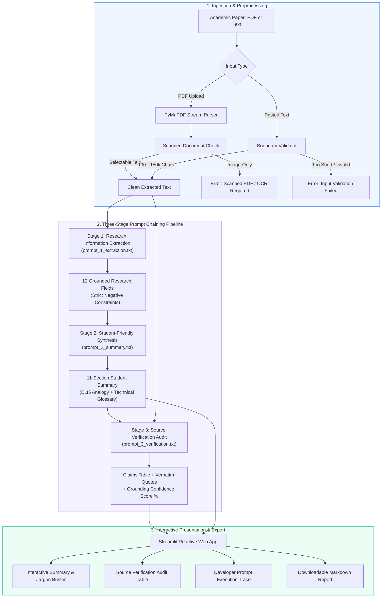

# PaperPilot AI 🎓

<div align="center">

### Intelligent Research Paper Summarizer & Source Verification Pipeline for Undergraduate Students

[](https://www.python.org/)
[](https://streamlit.io/)
[](https://ai.google.dev/)
[](https://pymupdf.readthedocs.io/)
[](https://docs.pytest.org/)
[](#academic-project-information)
[-0F172A?style=flat)](#academic-project-information)

<br/>

**A multi-stage, prompt-engineered academic assistant that transforms dense scholarly papers into verified, beginner-friendly structured summaries while eliminating hallucinations.**

[Key Features](#-key-features) • [How It Works](#-how-it-works--architecture) • [Prompt Engineering](#-prompt-engineering-design) • [Tech Stack](#-technology-stack) • [Installation](#-installation-and-setup) • [Usage Guide](#-usage-guide) • [Testing](#-testing-and-evaluation) • [Documentation](#-project-documentation)

</div>

---

## 📖 Project Overview

### The Problem Students Face
Undergraduate computer science, engineering, and data science students are required to read contemporary academic publications for coursework, literature surveys, and research seminars. However, novices encounter significant cognitive obstacles:
- **Dense Mathematical Formalisms:** Equations and abstract theoretical frameworks often obscure the foundational intuition.
- **Unstandardized Paper Structures:** Different conferences and journals organize experimental setups, ablation studies, and benchmarks in disparate formats.
- **Domain-Specific Jargon:** Technical abbreviations, acronyms, and terminology alienate beginner readers.
- **The LLM Hallucination Trap:** When students resort to generic, single-prompt AI chatbots, standard language models frequently:
  1. Fabricate plausible but completely fictitious quantitative results.
  2. Invent missing limitations when authors fail to state them.
  3. Produce generic prose blobs that omit crucial architectural details.

### What PaperPilot AI Solves
**PaperPilot AI** (Problem ID: `C15 — Research Paper Summariser for Students`) replaces naive, one-shot summarization with a deterministic, **auditable three-stage prompt chaining pipeline**. Instead of trusting an unconstrained model to summarize and explain in a single pass, PaperPilot AI isolates factual extraction, pedagogical synthesis, and adversarial source verification into distinct stages.

### Intended Audience
- **Undergraduate & Graduate Students:** Quickly comprehend literature without losing technical accuracy.
- **Early-Stage Researchers:** Screen large paper volumes, extract datasets and metrics, and identify open research gaps.
- **Teaching Assistants & Faculty:** Provide students with structured, verifiable reading aids.

### Project Goals
1. **Factual Grounding:** Zero tolerance for fabricated metrics, datasets, or nonexistent limitations.
2. **Pedagogical Translation:** Bridge high-level machine learning concepts using intuitive *"Explain Like I'm a Beginner"* analogies and jargon busters.
3. **Auditable Verification:** Perform an automated claim-by-claim cross-examination against the original text with verbatim evidence quotes and Grounding Confidence Scores.
4. **Developer Transparency:** Expose rendered prompt templates, execution latency, and token outputs via an integrated trace inspector.

---

## ✨ Features

- 📄 **Dual Ingestion Engine:** Upload digital academic PDF documents (up to 15MB) or paste raw scholarly text directly.
- 🔍 **Robust PyMuPDF Parsing:** In-memory stream extraction with page tracking and automatic detection of scanned or image-only documents lacking OCR.
- 🛡️ **Anti-Hallucination Guardrails:** Strict negative constraints force the model to explicitly output *"Not specified in the provided text"* when papers omit limitations, datasets, or future work.
- 🔬 **Stage 1 Factual Extraction:** Extracts 12 structured dimensions (problem, objective, methodology, datasets, quantitative findings, limitations, verbatim quotes).
- 📖 **Stage 2 Student-Friendly Summary:** Synthesizes extracted facts into 11 clear sections, featuring an intuitive real-world analogy (ELI5) and a jargon buster glossary.
- 🛡️ **Stage 3 Source Verification Audit:** Adversarially checks each summary claim against the original text, labeling claims as `[SUPPORTED]`, `[PARTIALLY SUPPORTED]`, `[UNSUPPORTED]`, or `[NOT VERIFIABLE]`.
- 📊 **Audit Metrics & Grounding Score:** Computes a quantitative Grounding Confidence Score %, total claims audited, and highlights discrepancies with suggested corrections.
- ⚠️ **Student Warning System:** Issues clear cautionary notices whenever claims cannot be verified against the source text.
- 💻 **Developer Trace Inspector:** View the exact rendered prompt templates, execution latencies, and raw outputs for each stage in the chain.
- 📥 **Export to Markdown:** Download structured summaries and verification audit logs as formatted Markdown (`.md`) with a single click.
- 📚 **Built-in Benchmark Papers:** One-click preloads for landmark papers:
  * **LoRA (Hu et al., 2021):** Full paper with quantitative benchmarks (10,000x parameter reduction, 3x memory savings).
  * **RAG (Lewis et al., 2020):** Multi-benchmark paper (21M passages, Natural Questions, FEVER).
  * **Incomplete Paper (FastGraph):** Edge case missing explicit limitations to evaluate negative guardrails.
- ⚙️ **Offline Heuristic Simulation Engine:** Fully exercises the UI, prompt trace inspector, and verification tables even without an active Gemini API key.

---

## 🏛️ How It Works — Architecture

PaperPilot AI decouples the summarization workflow into three distinct architectural tiers:



### Component Responsibilities

1. **Input Validation Module (`src/validation.py`):**
   - Enforces character boundaries (100 to 150,000 characters) and word count thresholds (>25 words).
   - Inspects binary file headers for the `%PDF-` magic byte sequence.
   - Computes character entropy to reject repetitive non-text sequences.
2. **PDF Processing Module (`src/pdf_processing.py`):**
   - Extracts digital text streams page-by-page using PyMuPDF (`pymupdf`).
   - Flags documents containing pages but fewer than 80 total extracted characters as scanned images needing OCR.
3. **AI Orchestration Service (`src/ai_service.py`):**
   - Coordinates the 3-stage prompt pipeline.
   - Interacts with Google Gemini API (`gemini-2.5-flash` or `gemini-1.5-flash`).
   - Implements a deterministic heuristic simulation engine when no API key is supplied.
4. **Verification & Badge Parser (`src/verification.py`):**
   - Parses Markdown table outputs from Prompt 3 into structured records.
   - Calculates weighted Grounding Confidence Scores:
     $$\text{Grounding Score} = \frac{N_{\text{supported}} \times 1.0 + N_{\text{partially}} \times 0.5 + N_{\text{unverifiable}} \times 0.5}{N_{\text{total}}} \times 100\%$$
   - Generates status badges (`🟢 [SUPPORTED]`, `🟡 [PARTIALLY SUPPORTED]`, `🔴 [UNSUPPORTED]`, `⚪ [NOT VERIFIABLE]`).

---

## 🎯 Prompt Engineering Design

PaperPilot AI implements **exactly THREE distinct logical prompts** in its production workflow.

```
+----------------------------------------------------------------------------------------------------+
|                                    STAGE 1: EXTRACTION PROMPT                                      |
|  Input: Raw Paper Text                                                                             |
|  Task: Extract 12 grounded research fields (Title, Problem, Objective, Questions, Methodology,     |
|        Datasets, Findings, Metrics, Limitations, Future Work, Conclusion, Verbatim Quotes).        |
|  Constraint: If detail is missing, state 'Not specified in the provided text'. Zero extrapolation.|
+-------------------------------------------------+--------------------------------------------------+
                                                  | Extracted 12 Fields
                                                  v
+----------------------------------------------------------------------------------------------------+
|                                    STAGE 2: SYNTHESIS PROMPT                                       |
|  Input: Extracted Research Information + Source Context                                            |
|  Task: Synthesize 11 student sections: Executive Overview, The Big Picture, Objectives, How It    |
|        Works, Experimental Setup, Key Findings, Limitations, Future Work, Conclusion,              |
|        'Explain Like I'm a Beginner' (ELI5 Analogy), and Technical Glossary (Jargon Buster).       |
|  Constraint: Strict fidelity to Stage 1 facts. Jargon terms must be explained intuitively.         |
+-------------------------------------------------+--------------------------------------------------+
                                                  | Generated Summary
                                                  v
+----------------------------------------------------------------------------------------------------+
|                                    STAGE 3: VERIFICATION PROMPT                                    |
|  Input: Original Source Text + Generated Stage 2 Summary                                           |
|  Task: Audit 4-8 primary summary claims against source text. Search for corroborating evidence.    |
|        Classify: [SUPPORTED], [PARTIALLY SUPPORTED], [UNSUPPORTED], [NOT VERIFIABLE].              |
|        Extract verbatim quotes, explain discrepancies, suggest corrections, compute Grounding Score.|
+----------------------------------------------------------------------------------------------------+
```

### Detailed Breakdown of the Three Prompts

#### Prompt 1: Research Information Extraction (`prompts/prompt_1_extraction.txt`)
- **Purpose:** Act as an objective, factual data extractor that establishes grounded truth anchors before summarization.
- **Input:** Raw paper text extracted from PDF or pasted input.
- **Key Directive:** *"If any field or detail is not explicitly mentioned in the source text, state exactly: 'Not specified in the provided text.' Do NOT extrapolate, speculate, or invent numbers."*
- **Output:** 12 structured fields including quantitative metrics, explicit limitations, and verbatim quotes.
- **Connection:** Feeds clean, structured factual units into Stage 2.

#### Prompt 2: Student-Friendly Structured Summary (`prompts/prompt_2_summary.txt`)
- **Purpose:** Act as an academic mentor and science communicator for undergraduate students.
- **Input:** Factual output from Stage 1 plus raw source excerpt context.
- **Key Directive:** Translate complex mechanisms into intuitive language without losing technical precision. Mandates an *"Explain Like I'm a Beginner"* (ELI5) analogy and a technical jargon glossary.
- **Output:** 11 comprehensive student sections.
- **Connection:** Passes the synthesized summary to Stage 3 for adversarial auditing.

#### Prompt 3: Source-Based Verification Audit (`prompts/prompt_3_verification.txt`)
- **Purpose:** Act as an independent, adversarial auditor cross-examining the summary against the original text.
- **Input:** Raw source text and Generated Stage 2 summary.
- **Key Directive:** Isolate each factual assertion, verify against the paper, classify into 4 standardized labels (`[SUPPORTED]`, `[PARTIALLY SUPPORTED]`, `[UNSUPPORTED]`, `[NOT VERIFIABLE]`), and provide verbatim quotes.
- **Output:** Claims Verification Table, audit metrics, Grounding Score %, critical student warnings, and truth disclaimer.

---

## 💻 Technology Stack

| Technology | Version | Purpose in PaperPilot AI | Selection Rationale |
|---|---|---|---|
| **Python** | `3.13.6` | Core Programming Language | Universal support for AI/NLP libraries, typing, and standard tooling. |
| **Streamlit** | `1.67.0+` | Web Application UI | Lightweight, reactive Python UI framework; rapid deployment without frontend bloat. |
| **Google Gemini API** | `gemini-2.5-flash` | LLM Inference Engine | Low latency, competitive reasoning, large context window, and official `google-genai` SDK. |
| **PyMuPDF (`pymupdf`)** | `2.1+` | PDF Stream Processing | Extremely fast in-memory PDF parsing, reliable text extraction, and page inspection. |
| **python-dotenv** | `1.2.4` | Environment Management | Secure loading of `GEMINI_API_KEY` from local `.env` files without hardcoding. |
| **Pandas** | `3.1.1` | Data Manipulation | Tabular formatting of claims verification matrices and test case CSV generation. |
| **Pytest** | `9.2.0` | Automated Software Testing | Robust unit testing framework validating input boundaries, parsers, and mock pipelines. |
| **ReportLab** | `5.1.0` | PDF Document Compilation | Programmatic generation of submission-ready Technical Reports and Milestone PDFs. |

---

## 📁 Project Structure

```text
PaperPilot-AI/
├── app.py                          # Streamlit web application & UI presentation
├── requirements.txt                # Production Python dependencies
├── README.md                       # Comprehensive project documentation
├── .env.example                    # Environment template for API keys
├── .gitignore                      # Git exclusion rules (protects credentials & caches)
├── generate_reports.py             # Script compiling official submission PDFs
├── TokenTitans_TechnicalReport.pdf # 28-Section Official Technical Report
├── TokenTitans_Milestone2.pdf      # Official Milestone 2 Submission Document
├── prompts/                        # Production prompt templates
│   ├── prompt_1_extraction.txt     # Stage 1: Information Extraction
│   ├── prompt_2_summary.txt        # Stage 2: Student-Friendly Summary
│   ├── prompt_3_verification.txt  # Stage 3: Source Verification Audit
│   └── prompt_versions/            # Iteration history (v1 through v4)
│       ├── v1_baseline.txt         # Version 1: Baseline zero-shot prompt
│       ├── v2_structured.txt       # Version 2: Structured section instructions
│       ├── v3_role_refined.txt     # Version 3: Role & negative constraint prompt
│       └── v4_chained_workflow.txt # Version 4: Chained workflow architecture
├── src/                            # Modular application source code
│   ├── ai_service.py               # AI orchestration, Gemini API & offline engine
│   ├── pdf_processing.py           # PyMuPDF digital extraction & scanned detector
│   ├── validation.py               # Input boundary & binary header validation
│   └── verification.py             # Markdown table parser & badge formatter
├── tests/                          # Automated unit test suite (27 tests)
│   ├── test_ai_service_offline.py  # Pipeline execution & negative constraint tests
│   ├── test_api_integration.py     # API configuration & fallback tests
│   ├── test_pdf_processing.py      # PDF extraction & scanned document tests
│   ├── test_prompts.py             # Prompt template integrity tests
│   ├── test_validation.py          # Input boundary & corruption tests
│   └── test_verification_parser.py # Audit metrics & table parser tests
├── sample_data/                    # Benchmark papers for testing
│   ├── sample_paper_1_lora.txt     # Benchmark paper: LoRA (Hu et al., 2021)
│   ├── sample_paper_1_lora.pdf     # Digital PDF version of LoRA paper
│   ├── sample_paper_2_rag.txt      # Benchmark paper: RAG (Lewis et al., 2020)
│   └── sample_paper_3_incomplete.txt # Edge case: FastGraph (Missing limitations)
└── docs/                           # Project documentation
    ├── prompt_iteration_log.md     # 4-version iteration history with observations
    ├── test_cases.md               # 14 comprehensive test cases & results
    ├── test_cases.csv              # Test matrix in CSV format
    ├── architecture.md             # System architecture & sequence diagrams
    ├── team_contributions.md       # Proposed team contribution split
    ├── demo_reel_script.md         # 120-second video presentation script
    ├── milestone2_form_answers.md  # Copy-paste ready MS Form answers (Q1-Q24)
    ├── technical_report.md         # Markdown version of Technical Report
    └── milestone2_submission.md    # Markdown version of Milestone 2 submission
```

---

## ⚡ Installation and Setup

Follow these step-by-step instructions to run PaperPilot AI locally on your system:

### 1. Clone the Repository
```bash
git clone https://github.com/pranjalofficial32/PaperPilot-AI.git
cd PaperPilot-AI
```

### 2. Create a Virtual Environment

- **macOS / Linux:**
  ```bash
  python3 -m venv venv
  source venv/bin/activate
  ```
- **Windows (Command Prompt / PowerShell):**
  ```cmd
  python -m venv venv
  venv\Scripts\activate
  ```

### 3. Install Dependencies
```bash
pip install --upgrade pip
pip install -r requirements.txt
```

### 4. Configure Google Gemini API Key
Create a `.env` file from the provided template:
```bash
cp .env.example .env
```
Open `.env` in any text editor:
```env
GEMINI_API_KEY=your_actual_gemini_api_key_here
GEMINI_MODEL=gemini-2.5-flash
```

> **How to get an API Key:**
> 1. Visit [Google AI Studio](https://aistudio.google.com/).
> 2. Sign in with your Google account and click **"Get API key"**.
> 3. Create a free API key and paste it into `.env` (or enter it directly in the app sidebar).
>
> *(Note: If no API key is provided, the application runs automatically in verified Offline Simulation Mode for demonstration and testing).*

### 5. Launch the Application
```bash
streamlit run app.py
```
Your default web browser will open at:
```text
http://localhost:8501
```

### 6. Troubleshooting Common Issues
- **`ModuleNotFoundError: No module named 'src'` during testing:** Run pytest with `PYTHONPATH=. pytest -v`.
- **Port 8501 already in use:** Run on another port: `streamlit run app.py --server.port 8502`.
- **PyMuPDF deprecation notice:** The project uses `import pymupdf` directly for modern compatibility.

---

## 📖 Usage Guide

```
Step 1: Choose Input Method
├── [Option A] Upload PDF: Drag & drop any digital paper PDF (e.g. sample_paper_1_lora.pdf)
├── [Option B] Paste Text: Paste paper text into the input text area
└── [Option C] Quick-Load: Click 'LoRA Paper', 'RAG Paper', or 'Incomplete Paper' in the sidebar

Step 2: Run Pipeline
└── Click '🚀 Run PaperPilot AI' and observe the 3-stage progress bar

Step 3: Explore Results Across Tabs
├── 📖 Student-Friendly Summary: Read 11 sections, ELI5 analogy, and jargon buster
├── 🛡️ Source Verification Audit: Review Claims Table, status badges, and Grounding Score %
├── 🔬 Structured Extraction: Inspect raw 12-field output from Stage 1
└── 💻 Prompt Execution Traces: Inspect rendered prompts, latency, and tokens

Step 4: Export Summary
└── Click '📥 Download Summary (Markdown)' to save the verified summary
```

---

## 🧪 Testing and Evaluation

PaperPilot AI adheres to a dual Quality Assurance (QA) strategy separating automated software tests from AI factual evaluation:

### 1. Automated Software Tests (`pytest`)
Automated tests validate input validation, binary stream parsing, scanned document detection, markdown table parsers, metric weighting calculations, and API error fallback behavior.

Run the test suite:
```bash
PYTHONPATH=. pytest -v
```

**Results:** **27 passed in 0.92s (100% Pass Rate)**

| Test Module | Tests | Status | Coverage Focus |
|---|---|---|---|
| `tests/test_validation.py` | 10 | **PASSED** | Empty text, boundary limits, short text, gibberish, magic headers, oversized files |
| `tests/test_pdf_processing.py` | 5 | **PASSED** | Valid sample PDF extract, empty streams, corrupted files, scanned image detection |
| `tests/test_prompts.py` | 5 | **PASSED** | Prompt templates existence, placeholder variables, version integrity |
| `tests/test_verification_parser.py` | 3 | **PASSED** | Markdown table parser, metric counts, grounding calculations, status badges |
| `tests/test_ai_service_offline.py` | 2 | **PASSED** | End-to-end 3-stage chain execution, negative constraint verification |
| `tests/test_api_integration.py` | 2 | **PASSED** | API key handling, graceful error fallback without unhandled exceptions |

### 2. Comprehensive Test Cases Table (14 Unique Inputs)
Documented in [docs/test_cases.md](docs/test_cases.md) and [docs/test_cases.csv](docs/test_cases.csv):

| Test ID | Category | Specific Input | Expected Result | Actual Result | Status |
|---|---|---|---|---|---|
| **TC-01** | Normal Case | Pasted LoRA paper text (6,569 chars) | 11 sections; ELI5; 5/5 claims Supported | Produced 11 sections; Grounding: 100.0% | **PASS** |
| **TC-02** | PDF Input | Digital PDF `sample_paper_1_lora.pdf` | Clean text extract; executes 3 stages | Extracted 6,569 chars across 2 pages | **PASS** |
| **TC-03** | Missing Info | FastGraph paper (missing limitations) | Outputs *"Not specified in provided text"* | Stated *"Not specified..."*; 0 hallucination | **PASS** |
| **TC-04** | Numerical | Paper with 10,000x and 3x GPU savings | Captures exact numbers without drift | Captured 10,000x and 3x verbatim | **PASS** |
| **TC-05** | Short Text | Text < 100 chars (30 chars, 7 words) | Rejected with minimum length requirement | Rejected: *"Input text is too short..."* | **PASS** |
| **TC-06** | Long Text | Input string > 150,000 characters | Rejected with max limit error & guidance | Rejected: *"Input exceeds max limit..."* | **PASS** |
| **TC-07** | Empty Input | Empty string or whitespace | Rejected immediately with input prompt | Rejected: *"Input is empty..."* | **PASS** |
| **TC-08** | Corrupted PDF | Non-PDF file renamed to `.pdf` | Binary header validator rejects file | Rejected: *"Corrupted or invalid file..."* | **PASS** |
| **TC-09** | Scanned PDF | Scanned image PDF (0 selectable chars) | PyMuPDF flags document needing OCR | Rejected: *"Scanned or Image-Only PDF..."* | **PASS** |
| **TC-10** | Gibberish | Low-entropy text (`aaaaa...` x100) | Entropy validator rejects gibberish | Rejected: *"Repetitive gibberish..."* | **PASS** |
| **TC-11** | Ambiguity | RAG latency vs accuracy trade-off | Stage 1 captures nuance under field 12 | Balanced synthesis preserved | **PASS** |
| **TC-12** | Adversarial | Injected claim: *"quantum simulator"* | Stage 3 audits claim as `[UNSUPPORTED]` | Flagged `[UNSUPPORTED]`; student warned | **PASS** |
| **TC-13** | Benchmark | RAG paper (21M passages, FEVER, NQ) | Accurately extracts DPR & BART metrics | Extracted benchmarks accurately | **PASS** |
| **TC-14** | Offline Mode | Execution without live `GEMINI_API_KEY` | Graceful fallback to deterministic mock | Safe fallback banner; no crashes | **PASS** |

---

## 🔄 Prompt Iteration Log

PaperPilot AI's prompt architecture progressed through four empirical iterations documented in [docs/prompt_iteration_log.md](docs/prompt_iteration_log.md):

```
+----------------------------------------------------------------------------------------------------+
|  Version 1: Baseline (v1_baseline.txt)                                                              |
|  - Prompt: "Summarize the following research paper in simple and plain language..."                 |
|  - Result: Generated unstructured prose; omitted quantitative metrics (10,000x, 3x) & limitations. |
|  - Status: REPLACED                                                                                |
+-------------------------------------------------+--------------------------------------------------+
                                                  | Force explicit academic sections
                                                  v
+----------------------------------------------------------------------------------------------------+
|  Version 2: Structured Instructions (v2_structured.txt)                                            |
|  - Prompt: Added 6 sections: Title, Problem, Methodology, Key Findings, Limitations, Conclusion.    |
|  - Result: Captured metrics, but invented plausible limitations when papers omitted them.          |
|  - Status: REPLACED                                                                                |
+-------------------------------------------------+--------------------------------------------------+
                                                  | Add mentor persona, negative constraints, ELI5
                                                  v
+----------------------------------------------------------------------------------------------------+
|  Version 3: Context & Role Refinement (v3_role_refined.txt)                                        |
|  - Prompt: Persona of academic assistant; rule: "If missing, state 'Not specified'"; ELI5 analogy.|
|  - Result: Eliminated invented limitations; single prompt cognitive overload led to subtle drift.  |
|  - Status: REPLACED                                                                                |
+-------------------------------------------------+--------------------------------------------------+
                                                  | Decouple into 3 specialized stages
                                                  v
+----------------------------------------------------------------------------------------------------+
|  Version 4: Final Chained Workflow (prompts/prompt_1, prompt_2, prompt_3)                          |
|  - Stage 1 Extraction -> Stage 2 Student Synthesis -> Stage 3 Adversarial Source Verification Audit|
|  - Result: 100% grounding on benchmarks; verbatim quotes; detects missing sections & false claims. |
|  - Status: RETAINED IN PRODUCTION                                                                  |
+----------------------------------------------------------------------------------------------------+
```

---

## ⚠️ Known Limitations

1. **Scanned / Image-Only PDFs:** PyMuPDF parses digital selectable text streams. Bitmap images of scanned physical papers require external OCR preprocessing before upload (PaperPilot AI automatically detects and flags these files).
2. **Context Window Limits:** Very lengthy papers (>150,000 characters / ~40 pages) exceed single-pass context limits and must be segmented by chapter or section.
3. **Automated Verification Boundaries:** LLM-based source verification is an automated cross-check screening aid, not formal mathematical or scientific proof. Students must verify mission-critical citations against primary literature.
4. **External API Dependence:** Live AI inference requires an active internet connection and a valid Google Gemini API key.

---

## 🔮 Future Improvements (Proposed)

- [ ] **Client-Side OCR Integration:** Embed Tesseract.js / Tesseract OCR to automatically parse scanned PDF documents without external tools.
- [ ] **Multimodal Diagram & Table Parsing:** Use Gemini Vision capabilities to inspect architecture diagrams, charts, and mathematical figures.
- [ ] **Vector Retrieval Q&A:** Implement Faiss-based local vector search for conversational question-answering over book-length dissertations.
- [ ] **BibTeX & Citation Export:** Automatically generate BibTeX, APA, and IEEE citation entries for summarized papers.

---

## 🔒 Privacy & Security

- **Zero Hardcoded Secrets:** No API keys, credentials, or private tokens are hardcoded. All keys are loaded dynamically via `python-dotenv` or masked sidebar inputs.
- **Git Protection:** The `.gitignore` file strictly excludes `.env`, `*.env`, virtual environments, and caches.
- **In-Memory File Processing:** Uploaded PDFs are processed entirely in memory as byte streams; no uploaded user documents are written to disk.
- **Third-Party Data Policies:** When using the Google Gemini API, data handling is governed by [Google AI Studio Terms of Service](https://ai.google.dev/terms). Users should review institutional policies before uploading confidential, embargoed, or proprietary research manuscripts.

---

## 📸 Application Preview & Demo

```
+----------------------------------------------------------------------------------------------------+
|  PaperPilot AI 🎓                                                                                  |
|  Intelligent Research Paper Summarizer & Source Verification for Undergraduate Students            |
|  [Milestone 2]  [3-Stage Prompt Chaining]  [Source Verification]  [Anti-Hallucination Guardrails]  |
+----------------------------------------------------------------------------------------------------+
|  1. Provide Research Paper: (o) Upload PDF Document   ( ) Paste Paper Text                         |
|  [ 📄 sample_paper_1_lora.pdf (7.5 KB) ] -> [✅ Extracted 6,569 characters across 2 page(s)]     |
|  [ 🚀 Run PaperPilot AI ]                                                                          |
+----------------------------------------------------------------------------------------------------+
|  2. Summary & Verification Results:                                                                |
|  [ 100.0% Grounding Score ] [ 5 Claims Audited ] [ 5 Supported ] [ 0 Partially ] [ 0 Unsupported ] |
|                                                                                                    |
|  [ 📖 Student-Friendly Summary ]  [ 🛡️ Source Verification ]  [ 🔬 Extraction ]  [ 💻 Traces ]      |
|  ┌──────────────────────────────────────────────────────────────────────────────────────────────┐  |
|  │ # SECTION 1: Paper Title & Overview                                                          │  |
|  │ **LoRA: Low-Rank Adaptation of Large Language Models**                                       │  |
|  │                                                                                              │  |
|  │ # SECTION 6: Key Findings & Quantitative Results                                             │  |
|  │ - 10,000x reduction in trainable parameters compared to full fine-tuning                      │  |
|  │ - 3x reduction in GPU VRAM memory consumption during training                                │  |
|  │                                                                                              │  |
|  │ # SECTION 10: "Explain Like I'm a Beginner" (ELI5)                                           │  │
|  │ Imagine having a 1,000-page encyclopedia. Instead of reprinting the entire book every time a │  │
|  │ new fact is discovered, you simply attach a small 2-page sticky note inside the back cover...│  │
|  └──────────────────────────────────────────────────────────────────────────────────────────────┘  |
+----------------------------------------------------------------------------------------------------+
```

### Demonstration Video
- **Reel Script:** A complete second-by-second 120-second demonstration script is documented in [docs/demo_reel_script.md](docs/demo_reel_script.md).
- **Video Status:** `[PENDING RECORDING BY TEAM]` *(Link will be added upon upload).*

---

## 📚 Project Documentation

- 📑 **Official Technical Report (PDF):** [TokenTitans_TechnicalReport.pdf](TokenTitans_TechnicalReport.pdf) (All 28 sections, cover page, tables)
- 📑 **Milestone 2 Submission Document (PDF):** [TokenTitans_Milestone2.pdf](TokenTitans_Milestone2.pdf) (All 12 sections matching form requirements)
- 📝 **Prompt Iteration Log:** [docs/prompt_iteration_log.md](docs/prompt_iteration_log.md) (4 detailed versions)
- 🧪 **Comprehensive Test Cases:** [docs/test_cases.md](docs/test_cases.md) & [docs/test_cases.csv](docs/test_cases.csv) (14 completed cases)
- 🏗️ **System Architecture:** [docs/architecture.md](docs/architecture.md) (Tier diagrams & sequence flow)
- 👥 **Team Contribution Breakdown:** [docs/team_contributions.md](docs/team_contributions.md) (Proposed 50/50 split)
- 📋 **Milestone 2 MS Form Copy-Paste Answers:** [docs/milestone2_form_answers.md](docs/milestone2_form_answers.md) (Q1 to Q24)
- 🎬 **120-Second Demo Reel Script:** [docs/demo_reel_script.md](docs/demo_reel_script.md) (Second-by-second script)

---

## 🎓 Academic Project Information

- **Project Title:** PaperPilot AI: Research Paper Summarizer Using Prompt Engineering
- **Course:** SCSE4041 — Prompt Engineering
- **Milestone:** Milestone 2 (12 Marks)
- **Problem ID:** C15 — Research Paper Summariser for Students
- **Team Name:** Token Titans
- **Team ID:** `PE-B49-56`
- **Batch:** B49–B64
- **Team Members:**
  * **Aayushi Nagar** (Team Leader) — Enrollment No: `[Pending Confirmation]`
  * **Pranjal** (Team Member) — Enrollment No: `[Pending Confirmation]`

---

## 📄 License

*License Status: Pending final team and faculty review.*  
All academic rights reserved. Code is provided for educational evaluation under Course SCSE4041. An open-source license (such as MIT) will be added upon explicit authorization.

---

<div align="center">

**Developed with ❤️ by Team Token Titans**  
*PaperPilot AI — Making Scientific Research Transparent, Verifiable, and Student-Ready.*

</div>
