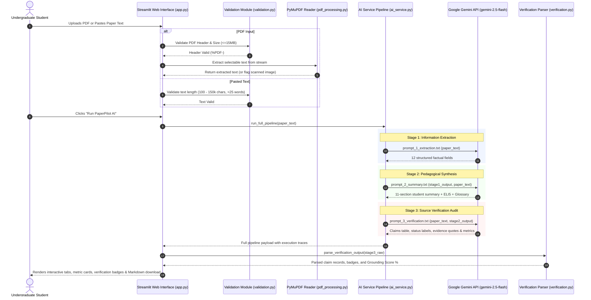

# PaperPilot AI — System Architecture & Workflow Pipeline

**Team:** Token Titans (`PE-B49-56`)  
**Project:** PaperPilot AI: Research Paper Summarizer Using Prompt Engineering  
**Problem ID:** C15 — Research Paper Summariser for Students  

---

## 1. High-Level Architecture Overview

PaperPilot AI is built upon a modular three-tier architecture separating the **Presentation Layer (Streamlit)**, **Data & Ingestion Layer (Validation & PyMuPDF)**, and **Inference & Reasoning Layer (Google Gemini API with Prompt Chaining)**.

```
+-----------------------------------------------------------------------------------+
|                           USER PRESENTATION LAYER (STREAMLIT)                     |
|  - Academic Hero UI         - PDF File Uploader       - Raw Text Input Area       |
|  - Sample Paper Selectors   - Metrics & Status Badges - Claims Verification Table |
|  - Downloadable Markdown    - Developer Trace Inspector                           |
+------------------------------------------+----------------------------------------+
                                           |
                                           v
+-----------------------------------------------------------------------------------+
|                        INGESTION & VALIDATION MODULES                             |
|  1. Input Validation (`src/validation.py`)                                        |
|     - Min/Max character boundaries (100 - 150,000 chars)                          |
|     - Word count threshold (>25 words)                                            |
|     - Repetitive gibberish detection (entropy check)                              |
|     - PDF magic header check (`%PDF-`)                                            |
|                                                                                   |
|  2. PDF Extraction (`src/pdf_processing.py`)                                      |
|     - PyMuPDF (`pymupdf`) stream reader                                           |
|     - Multi-page text aggregator with page numbering                              |
|     - Scanned / Image-Only PDF detector (< 80 chars across pages)                 |
+------------------------------------------+----------------------------------------+
                                           | Extracted Paper Text
                                           v
+-----------------------------------------------------------------------------------+
|                    3-STAGE PROMPT-ENGINEERING CHAIN (`src/ai_service.py`)         |
|                                                                                   |
|  [STAGE 1]: Research Information Extraction (`prompts/prompt_1_extraction.txt`)   |
|   * Goal: Strictly extract 12 factual research dimensions                         |
|   * Guardrail: Negative constraint ("Not specified in the provided text")         |
|                                     |                                             |
|                                     v Extracted Research Dimensions               |
|                                                                                   |
|  [STAGE 2]: Student-Friendly Structured Summary (`prompts/prompt_2_summary.txt`)  |
|   * Goal: Synthesize undergraduate-friendly explanation with ELI5 analogy         |
|   * Sections: 11 distinct sections + Technical Glossary (Jargon Buster)          |
|                                     |                                             |
|                                     v Generated Summary                           |
|                                                                                   |
|  [STAGE 3]: Source-Based Verification Audit (`prompts/prompt_3_verification.txt`) |
|   * Goal: Adversarially audit summary claims against raw source text             |
|   * Status Labels: [SUPPORTED], [PARTIALLY SUPPORTED], [UNSUPPORTED]              |
|   * Outputs: Claims Table, Discrepancies, Grounding Score %, Warnings            |
+------------------------------------------+----------------------------------------+
                                           |
                                           v
+-----------------------------------------------------------------------------------+
|                       VERIFICATION & FORMATTING ENGINE                            |
|  - Markdown table & metrics parser (`src/verification.py`)                        |
|  - Grounding confidence score calculator                                          |
|  - Dynamic status badge renderer                                                  |
+-----------------------------------------------------------------------------------+
```

---

## 2. The Three Logical Prompts in the Pipeline

The final solution implements **exactly THREE distinct logical prompts**:

1. **Stage 1: Research Information Extraction (`prompt_1_extraction.txt`)**
   - *Role:* Objective factual data extractor.
   - *Input:* Unstructured paper text.
   - *Output:* 12 structured fields: Problem, Objective, Questions, Methodology, Datasets, Key Findings, Quantitative Metrics, Limitations, Future Work, Conclusion, Evidence Quotes, Ambiguities.
   - *Prompt Engineering Techniques:* Zero-shot structured prompting, schema enforcement, strict negative guardrails (*"State 'Not specified in the provided text'"*), evidence grounding.

2. **Stage 2: Student-Friendly Structured Summary (`prompt_2_summary.txt`)**
   - *Role:* Academic mentor and science communicator.
   - *Input:* Factual output from Stage 1 + raw source excerpt context.
   - *Output:* 11 comprehensive student sections: Overview, The Big Picture, Objectives, Technical Methodology, Dataset/Setup, Key Findings, Limitations, Future Directions, Conclusion, ELI5 Analogy, Jargon Buster Glossary.
   - *Prompt Engineering Techniques:* Role prompting, pedagogical analogy generation, cognitive load reduction, jargon-busting constraints.

3. **Stage 3: Source-Based Verification Audit (`prompt_3_verification.txt`)**
   - *Role:* Adversarial factual auditor and truth verifier.
   - *Input:* Original raw paper text + Generated Stage 2 summary.
   - *Output:* Markdown claims verification table, verbatim evidence quotes, discrepancy corrections, audit metrics, student warnings, and ground-truth disclaimer.
   - *Prompt Engineering Techniques:* Adversarial cross-examination, chain-of-verification, multi-class claim classification, quantitative score synthesis.

---

## 3. Data Flow & Execution Sequence


